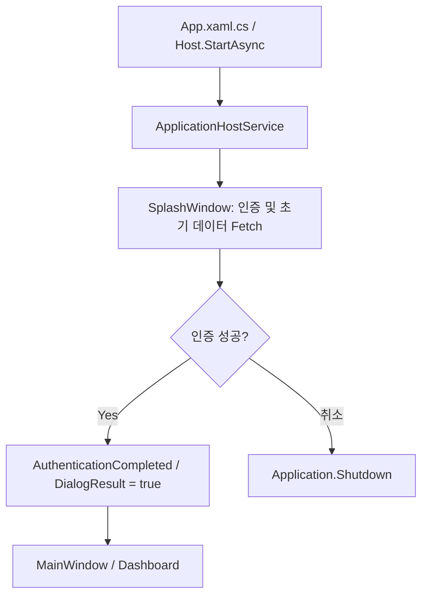
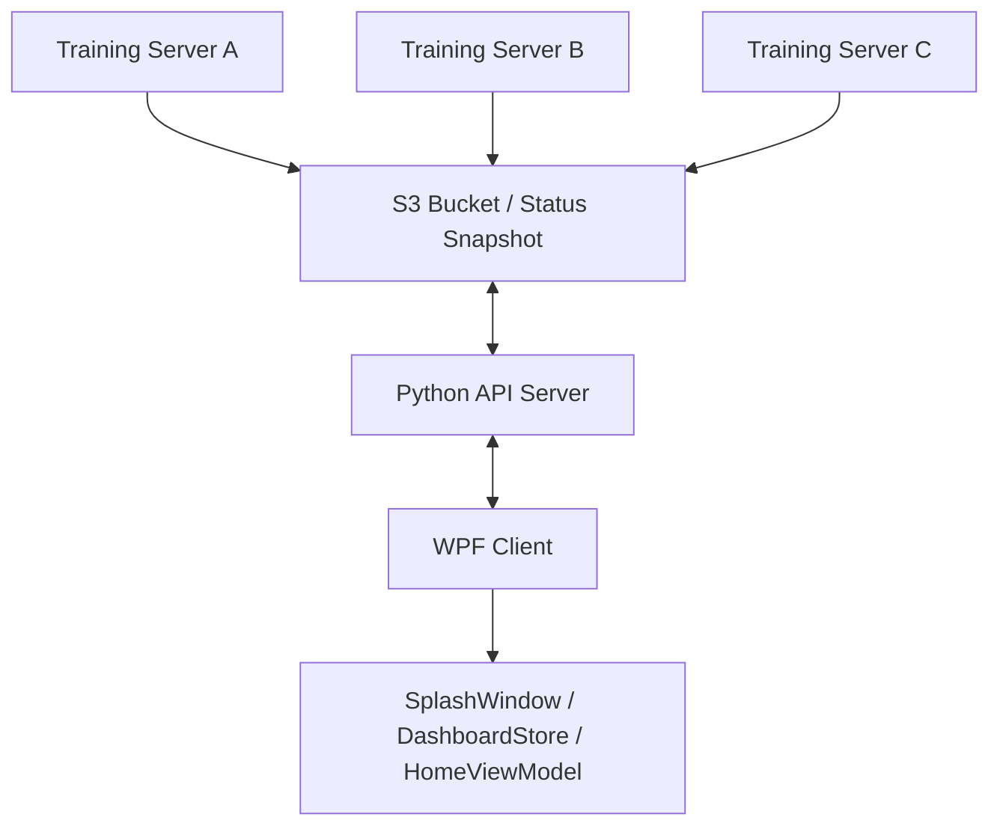

# WPF 학습 자동화 앱 개발 기록

- 기준일: 2026-11-28
- 범위: 명시적으로 기록 요청한 개발 사항. 기존 번호 유지.

## 1. UI 라이브러리 스타일 혼용

WPF UI를 기본 테마로 사용하고, 필요에 따라 MahApps.Metro 및 Material Design의 스타일을 부분적으로 적용한다.

- 특정 컨트롤 또는 Page의 `Resources`에 해당 라이브러리의 `ResourceDictionary`를 추가한다.
- `Style`, `ItemContainerStyle`을 명시적으로 지정할 수 있다.
- 전역 테마 중복 등록에 따른 스타일 충돌과 하위 컨트롤에 미치는 영향에 주의한다.

```xml
<ListBox>
    <ListBox.Resources>
        <ResourceDictionary>
            <ResourceDictionary.MergedDictionaries>
                <ResourceDictionary Source="pack://application:,,,/MahApps.Metro;component/Styles/Controls.xaml"/>
                <ResourceDictionary Source="pack://application:,,,/MahApps.Metro;component/Styles/Themes/Dark.Blue.xaml"/>
            </ResourceDictionary.MergedDictionaries>
        </ResourceDictionary>
    </ListBox.Resources>
</ListBox>
```

## 2. 테마에 따른 동적 색상

Material Design 및 WPF UI에는 Flet의 Surface, OnSurface, Primary처럼 테마에 따라 변경되는 색상 리소스가 존재한다.

### WPF UI

```xml
Background="{DynamicResource CardBackground}"
Foreground="{DynamicResource TextFillColorPrimaryBrush}"
```

```xml
Background="{ui:ThemeResource SolidBackgroundFillColorBaseBrush}"
```

| 역할 | Resource Key |
|---|---|
| 기본 배경 | `SolidBackgroundFillColorBaseBrush` |
| 보조 배경 | `SolidBackgroundFillColorSecondaryBrush` |
| 카드 배경 | `CardBackground` |
| 기본 텍스트 | `TextFillColorPrimaryBrush` |
| 보조 텍스트 | `TextFillColorSecondaryBrush` |
| 강조색 | `AccentFillColorDefaultBrush` |
| 테두리 | `ControlStrokeColorDefaultBrush` |

### Material Design

```xml
Background="{DynamicResource MaterialDesign.Brush.Background}"
Foreground="{DynamicResource MaterialDesign.Brush.Foreground}"
```

라이브러리 간 테마 변경은 별도로 동기화해야 한다.

## 3. 미기록

기존 번호 유지를 위해 비워 둔다.

## 4. Oracle DB 조회 성능 최적화

- 현재 `OracleDataReader` + `DataTable.Load(reader)` 방식 유지.
- `FetchSize`를 키워 네트워크 왕복 횟수를 줄인다.
- 1MB, 4MB, 16MB, 32MB 등으로 실제 성능 비교.
- 필요시 `MinimumCapacity`를 지정한다. 초기 메모리 사용량 증가에 주의한다.

```csharp
using var reader = command.ExecuteReader();
reader.FetchSize = 16 * 1024 * 1024;

var table = new DataTable
{
    MinimumCapacity = 1_000_000
};
table.Load(reader);
```

`DataTable.Load()`는 동기 메서드이므로 UI 스레드 차단을 피하기 위해 `Task.Run()` 등을 활용한다.

## 5. DataGrid 가상화

100만 행 수준의 대용량 데이터 렌더링 부하를 줄이기 위해 가상화를 활용한다.

```xml
<DataGrid
    ItemsSource="{Binding Table.DefaultView}"
    AutoGenerateColumns="True"
    EnableRowVirtualization="True"
    EnableColumnVirtualization="True"
    VirtualizingPanel.VirtualizationMode="Recycling"
    ScrollViewer.CanContentScroll="True"/>
```

- 행 가상화는 기본 활성화, 열 가상화는 기본 비활성화.
- Recycling 모드로 UI 컨테이너 재사용.
- 가상화는 UI 렌더링 최적화이며 실제 DataTable의 메모리 사용량을 줄이지는 않는다.

## 6. AutoGeneratingColumn 및 Code-behind

자동 컬럼 생성을 유지하면서 `AutoGeneratingColumn` 이벤트로 표시 여부, 이름, 너비 및 형식을 제어한다.

```xml
<DataGrid AutoGenerateColumns="True"
          AutoGeneratingColumn="DataGrid_AutoGeneratingColumn"/>
```

```csharp
private void DataGrid_AutoGeneratingColumn(
    object sender, DataGridAutoGeneratingColumnEventArgs e)
{
    if (e.PropertyName == "INTERNAL_ID")
        e.Column.Visibility = Visibility.Collapsed;
}
```

| 처리 | 방법 |
|---|---|
| 생성 제외 | `e.Cancel = true` |
| 숨김 | `e.Column.Visibility = Visibility.Collapsed` |
| 이름 변경 | `e.Column.Header` |
| 너비 변경 | `e.Column.Width` |

`LoadingRow`로 행 번호를 표시하는 것도 가능하다.

```csharp
private void DataGrid_LoadingRow(object sender, DataGridRowEventArgs e)
{
    e.Row.Header = e.Row.GetIndex() + 1;
}
```

정렬 및 필터링 후 행 번호 갱신 여부는 확인한다. 단순 표시를 위한 UI 로직은 Code-behind에서 처리해도 MVVM 위반이 아니다. 비즈니스 로직과 UI 로직을 분리한다.

## 7. DataContext 및 XAML 디자인 프리뷰

`DataContext = viewModel`로 지정하여 바인딩에서 `ViewModel.` 접두사를 생략한다. DI 구조는 유지 가능하다.

```csharp
public MainPage(MainPageViewModel viewModel)
{
    InitializeComponent();
    DataContext = viewModel;
}
```

```xml
<!-- 기존 -->
<TextBlock Text="{Binding ViewModel.Title}"/>
<!-- 변경 -->
<TextBlock Text="{Binding Title}"/>
```

디자인 타임 ViewModel 지정:

```xml
d:DataContext="{d:DesignInstance Type=vm:MainPageViewModel, IsDesignTimeCreatable=True}"
```

DI 생성자만 있는 ViewModel은 Designer에서 직접 생성하기 어렵다. `IsDesignTimeCreatable=False`로 타입만 지정하거나 `d:` 접두사를 이용해 프리뷰 데이터를 제공한다.

```xml
<TextBlock Text="{Binding Title}" d:Text="Preview Title"/>
<ProgressBar Value="{Binding Progress}" d:Value="70"/>
<d:Button Content="Preview Button"/>
```

프리뷰만을 위해 실제 ViewModel의 DI 구조를 변경할 필요는 없다.

## 8. Grid Overlay + IsLoading

작업 중 현재 Page만 반투명하게 가리고 NavigationView 및 다른 Page는 계속 사용 가능하도록 한다. 별도 DialogService나 DI 등록은 필요 없다.

### Resources

WPF 기본 제공 Converter 사용.

```xml
<BooleanToVisibilityConverter x:Key="BoolToVisibility"/>
```

### View

```xml
<Grid>
    <Grid>
        <DataGrid ItemsSource="{Binding Table.DefaultView}"/>
    </Grid>
    <Grid Panel.ZIndex="100"
          Background="#80000000"
          Visibility="{Binding IsLoading, Converter={StaticResource BoolToVisibility}}">
        <StackPanel HorizontalAlignment="Center" VerticalAlignment="Center">
            <ui:ProgressRing Width="40" Height="40" IsIndeterminate="True"/>
            <TextBlock Text="로딩 중..." Foreground="White" Margin="0,12,0,0"/>
        </StackPanel>
    </Grid>
</Grid>
```

### ViewModel

```csharp
[ObservableProperty]
private bool isLoading;

[RelayCommand]
private async Task FetchAsync()
{
    IsLoading = true;
    try
    {
        Table = await Task.Run(() => DBService.Fetch());
    }
    finally
    {
        IsLoading = false;
    }
}
```

- 기존 콘텐츠의 `IsEnabled`도 함께 제어하여 키보드 입력까지 차단한다.
- Overlay 자체가 아닌 Background의 Alpha 값으로 투명도를 조절한다.
- 반복 사용 시 공통 `LoadingContainer` 컨트롤로 분리하는 방안 고려.

## 9. SplashWindow → MainWindow 전환

기존 Generic Host 및 DI 구조를 유지하고 `ApplicationHostService`에서 Window 전환을 담당한다.



### SplashViewModel

```csharp
public event Action? AuthenticationCompleted;

[RelayCommand]
private async Task LoginAsync()
{
    bool success = await authService.AuthenticateAsync();
    if (success)
        AuthenticationCompleted?.Invoke();
}
```

### SplashWindow (Code-behind)

```csharp
ViewModel.AuthenticationCompleted += OnAuthenticationCompleted;
```

```csharp
private void OnAuthenticationCompleted()
{
    DialogResult = true;
}
```

Window 종료 시 이벤트 구독을 해제한다.

### ApplicationHostService

```csharp
var app = Application.Current;
app.ShutdownMode = ShutdownMode.OnExplicitShutdown;

var splash = serviceProvider.GetRequiredService<SplashWindow>();
if (splash.ShowDialog() != true)
{
    app.Shutdown();
    return Task.CompletedTask;
}

var mainWindow = serviceProvider.GetRequiredService<INavigationWindow>();
app.MainWindow = (Window)mainWindow;
mainWindow.ShowWindow();
mainWindow.Navigate(typeof(DashboardPage));
app.ShutdownMode = ShutdownMode.OnMainWindowClose;
return Task.CompletedTask;
```

### DI 등록

```csharp
builder.Services.AddTransient<SplashWindow>();
builder.Services.AddTransient<SplashViewModel>();
builder.Services.AddSingleton<INavigationWindow, MainWindow>();
builder.Services.AddSingleton<MainWindowViewModel>();
```

- Splash 종료 시 애플리케이션 전체가 종료되지 않도록 ShutdownMode 관리.
- 닫힌 Window는 재사용할 수 없으므로 재생성이 필요하면 Transient 사용.
- ViewModel에서 Window를 직접 제어하지 않는다.
- Window 생성과 전환은 UI 스레드에서 수행한다.

## 10. Home Dashboard 구성

1600×900 화면을 기준으로 NavigationView와 여러 Card를 활용한다.

| 영역 | 표시 정보 |
|---|---|
| 전체 현황 | 연결 서버 수, 사용 가능 GPU 수, 진행 및 대기 중인 학습 수 |
| 서버 현황 | 서버명, 연결 상태, GPU별 Idle / Training 상태 |
| 진행 중인 학습 | 실험 이름, 데이터셋, 서버/GPU, 진행률 |
| 학습 대기열 | 실험 이름, 데이터셋, 대기 순서 |
| 최근 학습 결과 | 실험 이름, 성공/실패, 완료 시각 |
| Quick Actions | 새 학습, 데이터셋 관리 등 자주 사용하는 기능 |

### 레이아웃 개념

```text
┌────────────┬────────────────────────────────────────────────────┐
│ Navigation │ Dashboard                           Refresh        │
│            ├────────────┬────────────┬────────────┬─────────────┤
│ Home       │ Servers    │ Free GPUs  │ Training   │ Pending     │
│ Training   ├────────────┴────────────┴────────────┴─────────────┤
│ Datasets   │ Server A           Server B          Server C      │
│ Models     │ GPU 0: Training    GPU 0: Training   GPU 0: Idle   │
│ History    │ GPU 1: Idle        GPU 1: Training                 │
│ Settings   ├────────────────────────────────────────────────────┤
│            │ Active Training                                    │
│            │ Experiment | Dataset | Server/GPU | Progress       │
│            ├─────────────────┬─────────────────┬────────────────┤
│            │ Pending Queue   │ Recent Results  │ Quick Actions  │
└────────────┴─────────────────┴─────────────────┴────────────────┘
```

### 구현 방향

- 서버 2~3대 및 서버별 GPU 개수에 동적으로 대응 (`ItemsControl` 중첩).
- GPU 사용률, VRAM, 온도 등 불필요한 하드웨어 정보 제외.
- Inference는 학습 상태와 별개로 취급.
- 서버 현황은 자원 중심, 학습 현황은 작업 중심으로 구성하여 중복 최소화.
- S3 통신 지연을 고려하여 SplashWindow에서 최초 Fetch.
- Singleton `DashboardStore`를 통한 초기 조회 결과 공유 고려.
- 이후 수동 새로고침 또는 주기적 갱신.

### 서버 데이터 수집 구조 (구현 후보)



S3 Snapshot 방식은 구현 후보이며 오래된 상태 정보는 `updated_at`을 기준으로 판단한다. 상태 정보가 오래되었거나 조회에 실패한 경우 GPU가 사용 가능하다고 단정하지 않는다.

---

## 전체 요약

| 번호 | 개발 항목 | 핵심 사항 |
|---|---|---|
| 1 | UI 라이브러리 혼용 | ResourceDictionary 적용 범위 제한 |
| 2 | 테마 색상 | DynamicResource 및 ThemeResource |
| 3 | 미기록 | — |
| 4 | Oracle DB 성능 | Load 유지, FetchSize 증가 |
| 5 | DataGrid 가상화 | Row, Column, Recycling |
| 6 | 컬럼 자동 생성 | AutoGeneratingColumn, UI Code-behind 허용 |
| 7 | 디자인 프리뷰 | DataContext 직접 지정, d: 활용 |
| 8 | 로딩 화면 | Grid Overlay + IsLoading |
| 9 | Splash 전환 | ApplicationHostService + Event + DialogResult |
| 10 | Home Dashboard | 서버/GPU/학습 현황 및 초기 Fetch |

> 라이브러리별 API와 Resource Key는 설치된 NuGet 버전에 따라 차이가 있을 수 있다. 예제는 설계 참고용이며 전체 프로젝트에서 실행 검증하지 않았다. HTTP 파일 전송, JSON 처리, Oracle Easy Connect, TempDirectory, Generic State, 저사양 기기용 페이징 등 명시적 기록 요청이 없었던 주제는 제외했다.
